# Poly Haven: Stone textures

**40 assets from [Poly Haven](https://polyhaven.com), dedicated to the public domain under [CC0](https://polyhaven.com/license).** Use them in any game, free or paid, and change them however you like; no credit is needed.

PBR textures as 1K and 2K JPG maps (colour, normal (GL and DX), roughness, AO, displacement and more). 894.6 MB in all.

This is a copy kept by [zuujis-cc0](https://github.com/zuujis-cc0) so game makers can take single files from GitHub. It is not made by or affiliated with Poly Haven: the originals, often in more formats and higher resolutions, are on [polyhaven.com](https://polyhaven.com). If they help you, consider [supporting Poly Haven](https://www.patreon.com/polyhaven/overview).

Every file is listed in [MANIFEST.tsv](MANIFEST.tsv) with its size and SHA-256. More free assets: [the Zuujis collection](https://github.com/zuujis-cc0/free-game-assets#readme).

| | | | |
| :-: | :-: | :-: | :-: |
| <a href="granite_tile_03">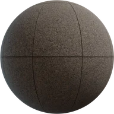</a> <b><a href="granite_tile_03">Granite Tile 03</a></b> by Charlotte Baglioni · <a href="https://polyhaven.com/a/granite_tile_03">source</a> | <a href="granite_tile_04">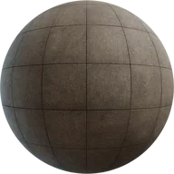</a> <b><a href="granite_tile_04">Granite Tile 04</a></b> by Amal Kumar · <a href="https://polyhaven.com/a/granite_tile_04">source</a> | <a href="granite_wall">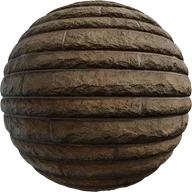</a> <b><a href="granite_wall">Granite Wall</a></b> by Dimitrios Savva · <a href="https://polyhaven.com/a/granite_wall">source</a> | <a href="grassy_cobblestone">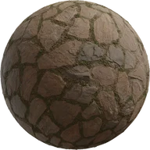</a> <b><a href="grassy_cobblestone">Grassy Cobblestone</a></b> by Charlotte Baglioni, Dario Barresi · <a href="https://polyhaven.com/a/grassy_cobblestone">source</a> |
| <a href="grey_cartago_01">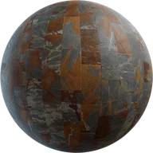</a> <b><a href="grey_cartago_01">Grey Cartago 01</a></b> by Jenelle van Heerden, Lucas Sánchez Ros · <a href="https://polyhaven.com/a/grey_cartago_01">source</a> | <a href="grey_cartago_02">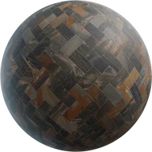</a> <b><a href="grey_cartago_02">Grey Cartago 02</a></b> by Jenelle van Heerden, Lucas Sánchez Ros · <a href="https://polyhaven.com/a/grey_cartago_02">source</a> | <a href="grey_cartago_03">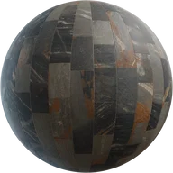</a> <b><a href="grey_cartago_03">Grey Cartago 03</a></b> by Lucas Sánchez Ros · <a href="https://polyhaven.com/a/grey_cartago_03">source</a> | <a href="grey_roof_tiles_02">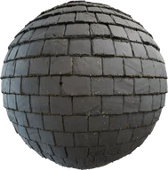</a> <b><a href="grey_roof_tiles_02">Grey Roof Tiles 02</a></b> by Rob Tuytel · <a href="https://polyhaven.com/a/grey_roof_tiles_02">source</a> |
|  <b><a href="grey_stone_path">Grey Stone Path</a></b> by Amal Kumar · <a href="https://polyhaven.com/a/grey_stone_path">source</a> | <a href="large_grey_tiles">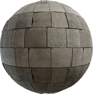</a> <b><a href="large_grey_tiles">Large Grey Tiles</a></b> by Rob Tuytel · <a href="https://polyhaven.com/a/large_grey_tiles">source</a> |  <b><a href="large_pebbles">Large Pebbles</a></b> by Charlotte Baglioni · <a href="https://polyhaven.com/a/large_pebbles">source</a> | <a href="lichen_rock">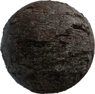</a> <b><a href="lichen_rock">Lichen Rock</a></b> by Rico Cilliers · <a href="https://polyhaven.com/a/lichen_rock">source</a> |
| <a href="marble_01">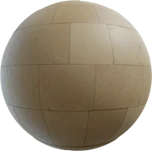</a> <b><a href="marble_01">Marble 01</a></b> by Rob Tuytel · <a href="https://polyhaven.com/a/marble_01">source</a> | <a href="marble_cliff_01">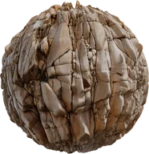</a> <b><a href="marble_cliff_01">Marble Cliff 01</a></b> by Amal Kumar · <a href="https://polyhaven.com/a/marble_cliff_01">source</a> | <a href="marble_cliff_02">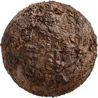</a> <b><a href="marble_cliff_02">Marble Cliff 02</a></b> by Amal Kumar · <a href="https://polyhaven.com/a/marble_cliff_02">source</a> | <a href="marble_cliff_03">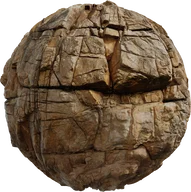</a> <b><a href="marble_cliff_03">Marble Cliff 03</a></b> by Amal Kumar · <a href="https://polyhaven.com/a/marble_cliff_03">source</a> |
| <a href="marble_cliff_04">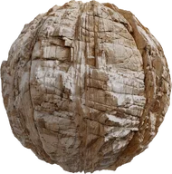</a> <b><a href="marble_cliff_04">Marble Cliff 04</a></b> by Amal Kumar · <a href="https://polyhaven.com/a/marble_cliff_04">source</a> | <a href="marble_cliff_05">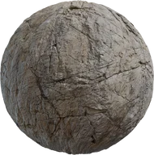</a> <b><a href="marble_cliff_05">Marble Cliff 05</a></b> by Amal Kumar · <a href="https://polyhaven.com/a/marble_cliff_05">source</a> | <a href="marble_cliff_06">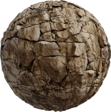</a> <b><a href="marble_cliff_06">Marble Cliff 06</a></b> by Amal Kumar · <a href="https://polyhaven.com/a/marble_cliff_06">source</a> | <a href="marble_rock_01">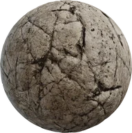</a> <b><a href="marble_rock_01">Marble Rock 01</a></b> by Amal Kumar · <a href="https://polyhaven.com/a/marble_rock_01">source</a> |
| <a href="marble_rock_02">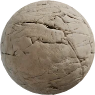</a> <b><a href="marble_rock_02">Marble Rock 02</a></b> by Amal Kumar · <a href="https://polyhaven.com/a/marble_rock_02">source</a> | <a href="marble_rock_03">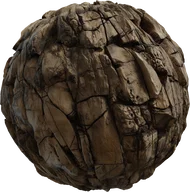</a> <b><a href="marble_rock_03">Marble Rock 03</a></b> by Amal Kumar · <a href="https://polyhaven.com/a/marble_rock_03">source</a> | <a href="marble_tiles">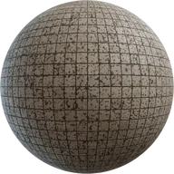</a> <b><a href="marble_tiles">Marble Tiles</a></b> by Charlotte Baglioni · <a href="https://polyhaven.com/a/marble_tiles">source</a> | <a href="medieval_blocks_05">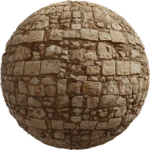</a> <b><a href="medieval_blocks_05">Medieval Blocks 05</a></b> by Rob Tuytel · <a href="https://polyhaven.com/a/medieval_blocks_05">source</a> |
| <a href="medieval_wall_02">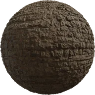</a> <b><a href="medieval_wall_02">Medieval Wall 02</a></b> by Rob Tuytel · <a href="https://polyhaven.com/a/medieval_wall_02">source</a> | <a href="mixed_rock_tiles">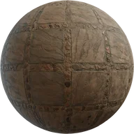</a> <b><a href="mixed_rock_tiles">Mixed Rock Tiles</a></b> by Dimitrios Savva · <a href="https://polyhaven.com/a/mixed_rock_tiles">source</a> | <a href="mixed_stone_tiles">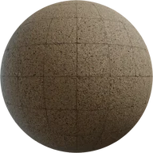</a> <b><a href="mixed_stone_tiles">Mixed Stone Tiles</a></b> by Dimitrios Savva · <a href="https://polyhaven.com/a/mixed_stone_tiles">source</a> | <a href="monastery_stone_floor">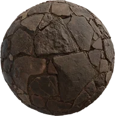</a> <b><a href="monastery_stone_floor">Monastery Stone Floor</a></b> by Amal Kumar · <a href="https://polyhaven.com/a/monastery_stone_floor">source</a> |
| <a href="mossy_cobblestone">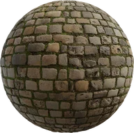</a> <b><a href="mossy_cobblestone">Mossy Cobblestone</a></b> by Sơn Nguyễn · <a href="https://polyhaven.com/a/mossy_cobblestone">source</a> | <a href="mossy_rock">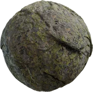</a> <b><a href="mossy_rock">Mossy Rock</a></b> by Rob Tuytel · <a href="https://polyhaven.com/a/mossy_rock">source</a> | <a href="mossy_stone_wall">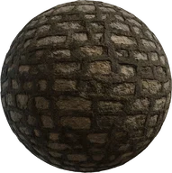</a> <b><a href="mossy_stone_wall">Mossy Stone Wall</a></b> by Amal Kumar · <a href="https://polyhaven.com/a/mossy_stone_wall">source</a> | <a href="multicolored_pebble_floor">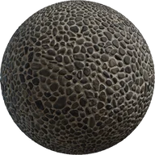</a> <b><a href="multicolored_pebble_floor">Multicolored Pebble Floor</a></b> by Dimitrios Savva · <a href="https://polyhaven.com/a/multicolored_pebble_floor">source</a> |
| <a href="old_stone_wall">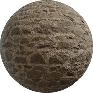</a> <b><a href="old_stone_wall">Old Stone Wall</a></b> by Charlotte Baglioni · <a href="https://polyhaven.com/a/old_stone_wall">source</a> | <a href="old_stone_wall_02">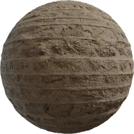</a> <b><a href="old_stone_wall_02">Old Stone Wall 02</a></b> by Charlotte Baglioni · <a href="https://polyhaven.com/a/old_stone_wall_02">source</a> | <a href="patterned_cobblestone">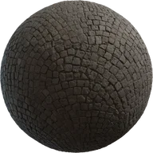</a> <b><a href="patterned_cobblestone">Patterned Cobblestone</a></b> by Rob Tuytel · <a href="https://polyhaven.com/a/patterned_cobblestone">source</a> | <a href="patterned_cobblestone_02">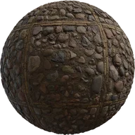</a> <b><a href="patterned_cobblestone_02">Patterned Cobblestone 02</a></b> by Rob Tuytel · <a href="https://polyhaven.com/a/patterned_cobblestone_02">source</a> |
| <a href="patterned_paving">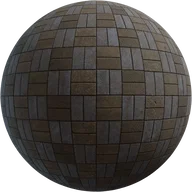</a> <b><a href="patterned_paving">Patterned Paving</a></b> by Charlotte Baglioni · <a href="https://polyhaven.com/a/patterned_paving">source</a> | <a href="patterned_paving_02">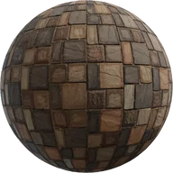</a> <b><a href="patterned_paving_02">Patterned Paving 02</a></b> by Dimitrios Savva · <a href="https://polyhaven.com/a/patterned_paving_02">source</a> | <a href="patterned_slate_tiles">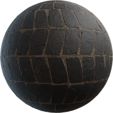</a> <b><a href="patterned_slate_tiles">Patterned Slate Tiles</a></b> by Dimitrios Savva · <a href="https://polyhaven.com/a/patterned_slate_tiles">source</a> | <a href="pavement_01">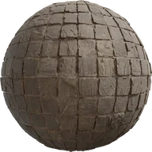</a> <b><a href="pavement_01">Pavement 01</a></b> by Rob Tuytel · <a href="https://polyhaven.com/a/pavement_01">source</a> |

---

Kept up to date by this repository's own [update workflow](.github/workflows/update.yml), with code and plan from [cc0-mirror](https://github.com/zuujis-cc0/cc0-mirror). Something wrong? [Open an issue there](https://github.com/zuujis-cc0/cc0-mirror/issues/new) or use the [private report form](https://games.zuujis.com/report).
